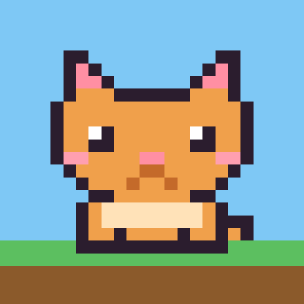

# 🐾 Pet Diary — пиксельный дневник питомца

Веб-приложение для владельцев домашних животных в стиле ретро-игр: питомец живёт на экране, радуется заботе и грустит, если о нём забыли. Под капотом — полноценный дневник: кормления и прогулки, медкарта с напоминаниями о прививках, график веса, учёт расходов и статистика.

**Демо:** https://dasha-sidorenko.github.io/pet-diary/

<p align="center">
  
</p>

## Возможности

### 🎮 Живой питомец
- Пиксельная анимация на canvas: питомец гуляет по сцене, моргает, подпрыгивает от радости, засыпает ночью
- Смена дня и ночи по реальному времени: солнце, облака, закат, звёзды и луна
- 5 видов (кошка, собака, грызун, птица, «другое») × 8 окрасов — 40 вариантов внешности
- Шкалы потребностей как в тамагочи: сытость, радость, бодрость, чистота. Они пополняются от записей и плавно убывают со временем
- Настроение питомца зависит от заботы; можно погладить — нажать на него 💕

### 📖 Дневник
- 10 быстрых действий одной кнопкой + заметки
- Журнал по дням с поиском и фильтром по типу
- Добавление записей задним числом, редактирование и удаление с кнопкой «Вернуть»

### ❤️ Здоровье
- Медкарта: прививки, обработки от паразитов, визиты к врачу, лекарства, процедуры
- Автоподстановка даты следующего раза (прививка — через год, обработка — через 3 месяца)
- Напоминания на главной, бейдж на вкладке и системные уведомления
- Экспорт события в календарь телефона (.ics) с напоминанием за день
- Кнопка «Сделано» — продлевает график в один клик
- График веса с динамикой

### 💰 Расходы
- Траты по категориям, переключение месяцев, сравнение с прошлым месяцем
- График за полгода
- Стоимость визита к врачу сразу попадает в расходы

### 🏆 Итоги
- Серии дней подряд, рекорды, календарь заботы за 15 недель
- 17 достижений с 8-битным звуком при открытии

### ⚙️ Прочее
- Несколько питомцев с быстрым переключением
- Светлая и тёмная темы (или как в системе)
- Резервная копия в JSON и восстановление, выгрузка журнала в CSV для Excel
- «Паспорт питомца» для печати или PDF — удобно взять к ветеринару
- PWA: устанавливается на телефон как приложение и работает без интернета
- Данные хранятся только на устройстве пользователя — без регистрации и серверов
- Автоматический перенос данных из первой версии дневника
- Доступность: навигация с клавиатуры, aria-атрибуты, учёт `prefers-reduced-motion`

## Стек

Без фреймворков и сборки — чистый HTML, CSS и JavaScript.

- **Canvas 2D** — пиксельный движок спрайтов и частиц
- **SVG** — графики веса, расходов и активности
- **Web Audio API** — 8-битные звуки без аудиофайлов
- **localStorage** — хранение данных с миграцией схемы
- **Service Worker + Web App Manifest** — офлайн-режим и установка
- **Notifications API**, `<dialog>`, CSS Grid, custom properties, `:has()`

## Структура

```
index.html            разметка всех экранов
css/style.css         пиксельная тема, светлая и тёмная палитры
js/utils.js           даты, склонения, форматирование, DOM-помощники
js/store.js           данные, миграция, потребности питомца, напоминания
js/sprites.js         спрайты, палитры, анимированная сцена
js/sound.js           8-битные звуки
js/charts.js          SVG-графики
js/ui.js              модальные формы, тосты, достижения, уведомления
js/views/*.js         экраны: главная, журнал, здоровье, расходы, итоги, настройки
js/app.js             роутинг, тема, онбординг, регистрация service worker
sw.js                 офлайн-кеш
manifest.webmanifest  установка на телефон
```

Новое быстрое действие добавляется одной строкой в массив `ACTIONS` в `js/store.js`.

## Как запустить

1. Склонируйте репозиторий:
   ```
   git clone https://github.com/dasha-sidorenko/pet-diary.git
   ```
2. Откройте `index.html` в браузере.

Для офлайн-режима и установки на телефон нужен http-сервер, например:
```
npx serve .
```

> При изменении файлов увеличьте версию `CACHE` в `sw.js`, чтобы у пользователей подтянулось обновление.

## Планы

- [ ] Синхронизация между устройствами
- [ ] Совместный доступ для всей семьи
- [ ] Фото питомца в записях
- [ ] Английская версия интерфейса
- [ ] Дополнительные сцены и наряды для питомца

## Автор

Дарья Сидоренко — Telegram: [@dasha_si1](https://t.me/dasha_si1)

© 2026 Дарья Сидоренко. Все права защищены.
